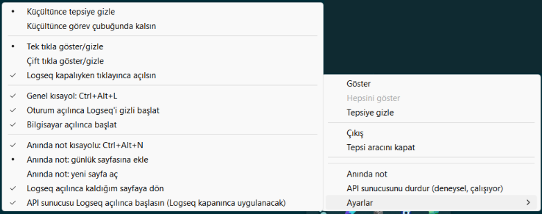
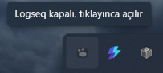
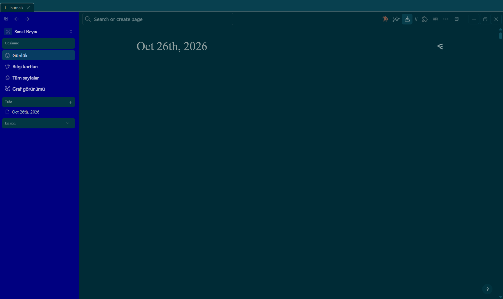

# logseq-tepsi

Logseq masaüstü uygulamasını küçültünce sistem tepsisine (bildirim alanı) gizleyen küçük Windows aracı. Logseq'in kendisinde tepsi özelliği yok; araç pencere işlemleri yapar ve eklentinin konuşabileceği yalnız-yerel bir uç açar. Dış ağ erişimi yok. Logseq'e dokunduğu yerler: `Logseq.exe`yi başlatmak (anında not ve API başlat/durdur için `logseq://` adresiyle), Logseq'in `127.0.0.1:12315` API portuna salt bağlantı yoklaması (istek göndermez; Logseq açıkken arka planda 2 sn'de bir), süreç listesinde bilinen Logseq yolunda `Logseq.exe` adlı sürecin varlığı ve Logseq kapalıyken `%APPDATA%\Logseq\configs.edn`de yalnız `:server/autostart` anahtarı.

**Bağlantılar:** [Sürümler (eklenti zip + `logseq-tepsi.exe`)](https://github.com/Ercaner1988/logseq-tepsi/releases) · [Eklenti](eklenti/README.md) · [Sorun bildir](https://github.com/Ercaner1988/logseq-tepsi/issues)

> **English.** Hides the Logseq desktop window to the Windows notification area (system tray) when minimized, with a global show/hide hotkey (`Ctrl+Alt+L`), a quick-note hotkey (`Ctrl+Alt+N`), a tray menu and a settings submenu. Two parts: the Windows tray tool (`logseq-tepsi.exe`, Rust, no network access, listens only on `127.0.0.1:47123`) and the Logseq plugin "Tepsi" that talks to it (hide button, commands, settings, reopen last page). Windows only. Install: download `logseq-tepsi.exe` from Releases, run `logseq-tepsi kur` once (adds a Startup shortcut and a URL scheme), then install the plugin from the Logseq marketplace. The UI is available in English and Turkish (follows the Windows display language by default). The documentation is in Turkish.



 

## Ne yapar

- Tepsiye tek simge koyar (Logseq'in kendi simgesi, ipucu "Logseq"). Logseq kapalıyken simge soluk (gri, yarı saydam) görünür ve ipucu "Logseq kapalı, tıklayınca açılır" der (tıklamak Logseq'i açar; ipucu `tik` ve `kapaliyken_tik_acar` ayarına göre değişir, kısayol kaydedilemediyse "kısayol kaydedilemedi" uyarısı ekler; iki kısayol aynı tuşa ayarlıysa "kısayollar çakışıyor" der); durum 2 sn'de bir yoklanır, yalnız değişince simge tazelenir. Simge eklenemezse ya da küçültme kancası kurulamazsa günlüğe yazar, artan gecikmeyle (1 sn ... 30 sn) yeniden dener; kanca yokken ipucu "küçültme izlenemiyor" der.
- Logseq ana penceresi simge durumuna küçültülünce gizler (görev çubuğu düğmesi kalkar; `kucultme = gorev_cubugu` ise gizlemez). Olay `SetWinEventHook(EVENT_SYSTEM_MINIMIZESTART)` ile yakalanır; yoklama yok, boşta CPU sıfır. Olay `IsIconic` tazelenmeden gelirse kısa gecikmeyle bir kez daha bakılır.
- Çok pencere: her pencere ayrı hatırlanır (gizlenenler kümesi). Sol tık: görünür pencere varsa hepsini gizler; yoksa en son gizleneni gösterir (geri yükler, öne getirir); Logseq hiç açık değilse Logseq'i başlatır (`kapaliyken_tik_acar = hayir` ise başlatmaz). Varsayılan `tik = tek` kipinde çift tık tek tık sayılır; `tik = cift` kipinde yalnız çift tık göster/gizle yapar, tek tık hiçbir şey yapmaz (seçilmeyen tık türü işe yaramaz).
- Açılışta tarama: araç Logseq açıkken başlarsa küçük pencereyi gizler (`kucultme = gorev_cubugu` iken gizlemez), zaten gizli olanı tepsiden geri getirilebilsin diye hatırlar.
- Sağ tık menüsü: Göster, Hepsini göster, Tepsiye gizle, Çıkış, Tepsi aracını kapat, **Anında not**, **API sunucusunu başlat/durdur (deneysel)** (Logseq kapalıyken soluk; etiket sunucunun durumunu söyler; eklentinin belgesiz `doAction` kanalına dayanır, canlı doğrulanana kadar "deneysel"), Ayarlar alt menüsü (aşağıda). Çıkış tüm Logseq ana pencerelerini kapatır (gizliyse önce görünür yapılır, sonra `WM_CLOSE`); araç tepside kalır, simgeye tıklayınca Logseq yeniden açılır. "Tepsi aracını kapat" yalnız aracı kapatır, Logseq'e dokunmaz (gizliyse önce gösterir). Oturum kapanırken (`WM_ENDSESSION`) gizli pencere gösterilir.
- Kapatma (X) düğmesine dokunmaz: Logseq kapanır, araç ve simge kalır.
- **Dil (arayüz iki dillidir: Türkçe ve English):** tepsi menüsü, Ayarlar alt menüsü, simge ipucu, `kur`/`kaldir` konsol çıktısı, başlangıç kısayolunun açıklaması ve yerel uçtan dönen insan-okunur nedenler (`POST /ayar` 400 gövdesi, `api_otomatik_neden`) `dil` ayarına göre yazılır. `otomatik` (varsayılan) Windows görüntü dilini izler (`GetUserDefaultUILanguage`; birincil dil Türkçeyse Türkçe, değilse English); `tr` ve `en` Windows dilini ezer. Ayarlar alt menüsünün sonunda **Dil** bölümü üç radyo öğesidir ("Dil: Otomatik (Windows dili)", "Dil: Türkçe", "Dil: English"; English arayüzde "Language: Automatic (Windows language)", "Language: Türkçe", "Language: English"); seçim anında uygulanır: tepsi ipucu hemen, menü bir sonraki açılışta yeni dilde olur. English etiketler örnek: Show, Show all, Hide to tray, Exit, Close tray tool, Quick note, Settings. Metinlerin tamamı `metin/` crate'indedir (her metin iki dilde; eksik çeviri derlenmez). **Dil dışında kalanlar:** ayar anahtarları ve değerleri (`evet`/`hayir`, `tepsi`, ...), yerel uç sözleşmesi (`GET /durum`, `anahtar=değer` gövdeleri, HTTP durum satırları) ve `gunluk.txt` (iç kayıt, Türkçe kalır). `--sina-*` sınama komutlarının çıktısı geliştirici tanısıdır, çevrilmez. Bu belgedeki menü ve ipucu metinleri Türkçe halleridir.
- Tek örnek: ikinci kopya hemen çıkar ama önce mevcut kopyaya "simgeyi yeniden ekle" iletisi yollar (simge, kanca ve açılış taraması tazelenir).
- Logseq yolu sabit değil. Sıra: çalışan ana pencerenin süreç yolu, `%LOCALAPPDATA%\logseq-tepsi\logseq-yolu.txt` (son bilinen yol, araç kendisi yazar), kayıt defteri Uninstall girdileri (HKCU, HKLM, WOW6432Node; `InstallLocation`, `DisplayIcon`, `UninstallString`; `DisplayVersion`ı en yüksek olan önce, sayısal karşılaştırma: `0.10.15` < `2.0.2`), son çare sabit yollar. Sürümü bilinen en yüksek kurulumdan düşük bir yol (örn. 2.x varken eski Squirrel) ayara yazılmaz, ayardan da okunmaz. İlk var olan kullanılır. Logseq ayrık süreç olarak başlatılır (`ELECTRON_RUN_AS_NODE` kaldırılır, stdio boş, DETACHED_PROCESS + yeni süreç grubu + izin varsa iş nesnesinden kopuk).
- Günlük: `%LOCALAPPDATA%\logseq-tepsi\gunluk.txt` (UTC, 64 KB'ta `gunluk.eski.txt`'ye döner; panik iletisi de buraya).
- DPI: çalışma zamanında `PER_MONITOR_AWARE_V2` istenir (manifest yok).
- **Anında not** (genel kısayol `kisayol_not`, varsayılan `Ctrl+Alt+N`, ya da menüdeki "Anında not"): Logseq gizliyse gösterip öne getirir; kapalıysa başlatır ve ana pencere görünene **ve eklenti araca kendini gösterene** kadar bekler (en çok 60 sn, 500 ms aralıkla; eklenti haber vermese de pencere görünürse süre dolunca bir kez denenir); sonra `Logseq.exe "logseq://x-callback-url/invokeCommand?action=plugin.logseq-tepsi.models.anindaNot&payload=<hedef>"` çalıştırır. Adres Logseq'in çalışan örneğine gider ve eklentinin `anindaNot` modelini çağırır: `gunluk` bugünün günlük sayfasının sonuna boş blok, `yeni_sayfa` "Not YYYY-MM-DD HH:mm" adlı sayfa (çakışırsa sonuna sayı); sayfaya gider ve bloğu düzenlemeye açar. Eklenti yüklenmeden gelen adres Logseq'te sessizce kaybolur, bu yüzden hazır olma beklenir. Hazır işareti: izinli `Origin` ile yetkili bir istek (eklentinin açılıştaki `GET /ayar`ı) gelince temas zamanı (unix ms) olarak kaydedilir; yalnız ŞU ANKİ ana Logseq sürecinin başlangıcından (`GetProcessTimes`) sonraki temas hazır sayılır, yani Logseq kapanıp hızla yeniden açılsa bile önceki örneğin teması yeni eklenti yüklenmeden adresin gitmesine yol açmaz. İşaret ayrıca Logseq kapalı görüldükçe ve araç Logseq'i kendisi başlatırken anında sıfırlanır. Bir not hazırlığı sürerken gelen ikinci istek yok sayılır.
- **API sunucusu** (Logseq'in `127.0.0.1:12315` HTTP API sunucusu): araç kısa bir TCP bağlantısıyla (300 ms) çalışıp çalışmadığını bilir (`GET /durum` sonuna `api=acik|kapali` canlı yoklamayla; menü etiketi arka plan iş parçacığının 2 sn'de bir güncellediği son durumu kullanır, Logseq kapalıyken yoklanmaz: menü açılışı 300 ms'lik yoklamayla beklemez). Menüden başlat/durdur, eklentinin `apiSunucusu` modelini aynı adres yoluyla çağırır (eklentinin `window.top.apis.doAction` erişimi **canlı doğrulanmadı**, aşağıda; bu yüzden menü etiketleri ve eklenti komutları "(deneysel)" diye işaretlidir). `api_otomatik_baslat` ayarı Logseq'in `configs.edn` dosyasındaki `:server/autostart` değeridir (aşağıda).

## Ayarlar

Tek kaynak: `%LOCALAPPDATA%\logseq-tepsi\ayar.toml` (TOML; değerler dizge, `evet`/`hayir`). Tepsi menüsündeki **Ayarlar** alt menüsü, eklenti ayarları ve `GET/POST /ayar` aynı ayarları okur/yazar; seçim anında uygulanır ve kaydedilir (geçici dosya + yeniden adlandırma ile atomik yazma).

| Anahtar | Değerler (varsayılan ilk) | Ne yapar |
| --- | --- | --- |
| `kucultme` | `tepsi`, `gorev_cubugu` | `tepsi`: küçültünce Logseq tepsiye gizlenir. `gorev_cubugu`: küçültme kancası gizlemez (menüdeki "Tepsiye gizle" ve `POST /gizle` yine gizler) |
| `tik` | `tek`, `cift` | Tepsi simgesinde hangi tık göster/gizle yapar; seçilmeyen tık türü hiçbir şey yapmaz. Sağ tık menüsü her kipte açılır |
| `kapaliyken_tik_acar` | `evet`, `hayir` | Logseq kapalıyken simge tıkı Logseq'i başlatsın mı (menüdeki Göster ve genel kısayol her zaman başlatır) |
| `kisayol_goster_gizle` | `Ctrl+Alt+L`; boş = kapalı | Genel kısayol (`RegisterHotKey`): görünürse gizler, gizliyse gösterir, kapalıysa Logseq'i başlatır. `Ctrl`, `Alt`, `Shift`, `Win` + harf/rakam/`F1`-`F24`/`Space`/`Enter`/`Tab`/`Esc`/ok ve gezinme tuşları; büyük/küçük harf duyarsız, yalnız ASCII; en az bir `Ctrl`/`Alt`/`Win` gerekir (`Shift` tek başına yalnız F tuşuyla). Dosyada ve uçta kurallı yazımla (`Ctrl+Alt+L`) saklanır. Kayıt başarısızsa (başka program kullanıyor) günlüğe (yalnız ilk başarısızlıkta) yazılır ve ipucu uyarır; bakım zamanlayıcısı kaydı başarısız kısayolu artan gecikmeyle (1 sn ... 30 sn) yeniden dener (açılışta, Explorer yeniden başlayınca, ikinci kopyada ve çalışırken ayar değişince de planlanır: çalışırken tuşu başka program tutuyorsa kayıt kalıcı eksik kalmaz). Ayar değişince değişen kısayolların hepsi önce bırakılır, sonra kaydedilir (iki kısayol yer değiştirebilir). Menüden kapatınca boşalır, açınca varsayılan yazılır |
| `oturumda_gizli_baslat` | `hayir`, `evet` | Yalnız araç başlangıç kısayolundan `--oturum` argümanıyla başlarsa: Logseq açık değilse başlatır, ana penceresi görününce (en çok 90 sn, 1 sn aralıkla yoklanır) tepsiye gizler. Elle başlatmada etkisizdir |
| `baslangicta_calis` | `evet`, `hayir` | Dosyada TUTULMAZ: başlangıç kısayolunun (`Startup\Logseq-tepsi.lnk`) varlığıdır. Menüdeki "Bilgisayar açılınca başlat" işareti ve `GET /ayar` bunu gösterir; değiştirmek kısayolu kurar/siler (URL şemasına dokunmaz) |
| `kisayol_not` | `Ctrl+Alt+N`; boş = kapalı | Anında not için genel kısayol (ikinci `RegisterHotKey` kimliği; yazım kuralları `kisayol_goster_gizle` ile aynı, kayıt hatası aynı ipucu uyarısında görünür; menüden kapatınca boşalır, açınca varsayılan yazılır). `kisayol_goster_gizle` ile AYNI kısayol olamaz: `POST /ayar` 400 + neden verir, menü isteği günlüğe yazılıp reddedilir (menü etiketi varsayılanın çakıştığını söyler); iki ayar aynı gövdede yer değiştirirse (takas) kabul edilir |
| `not_hedefi` | `gunluk`, `yeni_sayfa` | Anında not nereye yazılır (yukarıda); adresin `payload` değeri olarak eklentiye gider |
| `kalinan_sayfa` | `evet`, `hayir` | Eklenti, Logseq açılışında son bakılan sayfaya dönsün mü. Dosyada tutulur ve eklenti ayarıyla eşitlenir; dönüşü eklenti yapar ([eklenti README](eklenti/README.md)) |
| `api_otomatik_baslat` | `evet`, `hayir` | Dosyada TUTULMAZ: gerçek kaynak `%APPDATA%\Logseq\configs.edn` içindeki üst düzey `:server/autostart` değeridir (anahtar yok ya da `nil` = `hayir`). Aşağıdaki "API sunucusu otomatik başlatma" |
| `dil` | `otomatik`, `tr`, `en` | Arayüz dili (yukarıdaki "Dil" maddesi). `otomatik`: Windows görüntü dili Türkçeyse Türkçe, değilse English; `tr`/`en` açık seçim. Dosyada tutulur; büyük/küçük harf duyarsız, geçersiz değer `POST /ayar`da 400 verir. Menüden (Ayarlar > Dil), eklentiden ve `POST /ayar`dan değişir |

### API sunucusu otomatik başlatma (`configs.edn`)

Logseq `:server/autostart` değerini açılışta okur (asar: `electron.server/reset-state!`, `server-indicator` bileşeni `:autostart` doğruysa 1 sn sonra `:server/do :restart` yollar). Araç bu anahtarı şöyle yönetir:

- **Yazma yalnız Logseq kapalıyken.** Logseq açıkken verilen istek (menü, `POST /ayar`, eklenti) `ayar.toml`a `api_bekleyen = "evet"|"hayir"` olarak yazılır (uçtan değiştirilemez); menü etiketi, `GET /ayar` (`api_otomatik_bekleyen`) ve eklenti "Logseq kapanınca uygulanacak" der. "Logseq kapandı" kuralı menüden gelen istekte de durum yoklamasındaki bekleyen yolunda da AYNIDIR: ana pencere yok **ve** `Logseq.exe` süreci yok (`CreateToolhelp32Snapshot`; yalnız bilinen Logseq yollarındaki süreç sayılır, aynı adlı başka program sayılmaz; yolu okunamayan süreç ve alınamayan süreç listesi, `Process32FirstW` başarısızlığı dahil, var sayılır) **ve** pencere 2 sn aralıklı **ardışık 2 durum yoklamasında** yok (kapanış yazımı bitsin diye pencere kaybolduktan en erken ~2, en geç ~4 sn sonra). Biri sağlanmıyorsa menüden gelen istek de bekletilir, dosyaya yazılmaz. İstenen zaten gerçek değerse bekleyen silinir, yazılmaz. `POST /ayar` ayarı pencere iş parçacığında eşzamanlı uygular ve sonucu yanıtta söyler (aşağıda): yazıldı, beklemede ya da hata + neden. `configs.edn` okunamazsa ya da yapısı beklenmedikse gerçek değer bilinmez: istek `hata` + neden döner (`false` varsayılıp "yazıldı" denmez), bekleyen yazım için bekleyen silinir ve neden günlüğe yazılır.
- **Dar metin düzenleyici** (`logseq/src/edn.rs`; tam EDN ayrıştırıcı değil): üst düzey `{ ... }` haritasının elemanlarını bulur (dizge, `;` yorum, `\x` karakter sabiti, iç içe `{ [ (`, `#{}`, `#"..."`, etiketli öğe farkında). `:server/autostart` varsa yalnız değeri (`true`/`false`) değişir (mevcut değer `true`/`false`/`nil` değilse üstüne yazılmaz); `##Inf`/`##-Inf`/`##NaN` sembolik değerleri etiket değil tek simgedir; yoksa kapanış `}`'den önce dosyanın satır sonu (LF/CRLF) ve girintisiyle eklenir; öbür baytlar aynen kalır, UTF-8 BOM korunur. Çıktı yazılmadan önce yeniden ayrıştırılır (sigorta): anahtar tam bir kez ve beklenen değerde değilse yazılmaz. **Beklenmeyen yapıda yazma reddedilir** (`#_`, `^`, harita olmayan üst düzey, kapanmamış kap, artık içerik, tek sayıda eleman, çift anahtar, `true/false/nil` olmayan değer) ve günlüğe yalnız sabit neden yazılır.
- İlk yazımdan önce bir kez `configs.edn.tepsi-yedek` alınır (yedek alınamazsa yazılmaz); yedek de yazma da atomiktir (`configs.edn.tepsi-yedek-tmp` / `configs.edn.tepsi-tmp` + yeniden adlandırma; yarım yedek kalmaz). **Yedek, dosyanın tamamını, yani `:server/tokens` içindeki token'ları da içerir**: depoya, paylaşıma ya da buluta koymayın.
- Dosya içeriği, token ve değerler günlüğe, hata iletisine ya da sınama çıktısına HİÇ basılmaz (dosyada `:server/tokens` var); sınamalar sözcük listesinden üretilmiş sahte içerikle çalışır, gerçek `configs.edn`e dokunulmaz.
- API sunucusu çalışıyor mu: `127.0.0.1:12315`e 300 ms'lik TCP bağlantısı (adres Logseq'in varsayılanıdır: asar `get-host`/`get-port` varsayılanları `127.0.0.1`, `12315`; `:server/host`/`:server/port` ile değiştirilmişse yoklama yanılır).

Dosya eksikse varsayılanlarla çalışılır (günlüğe yazılır). Dosyanın içeriği bozuksa (TOML hatası, geçersiz değer ya da UTF-8 olmayan bayt) `ayar.toml.bozuk-<unix saniye>` adıyla kenara alınır (eski kenar dosyalarının üstüne yazılmaz; aynı saniyede sonek alır), varsayılanlarla çalışılır ve günlüğe yazılır; kenara alınamazsa dosyanın üstüne hiç yazılmaz. Dosya okunamıyorsa (kilit, izin gibi G/Ç hatası; içerik bozuk demek değildir) dosyaya dokunulmaz, varsayılanlarla çalışılır ve o oturumda üstüne yazılmaz. Tanınmayan anahtar uyarıyla korunur: ilk kayıtta ve sonrakilerde aynen geri yazılır.

## Yerel uç (eklenti için, sözleşme sabit)

`127.0.0.1:47123` (yalnız döngü adresi; bağlanamazsa günlüğe yazılır, araç çalışır). Bloklayıcı `accept` (boşta CPU sıfır); her bağlantı kendi iş parçacığında işlenir (aynı anda en çok 8, fazlasına hemen 503): yavaş ya da asılı bir istemci (2 sn okuma süresi) diğerlerini bekletmez. Okuma süresini kısaltmak yerine bu seçildi, çünkü kısaltma tıkanmayı yalnız azaltır, bağlantı başına iş parçacığı sınırlı sayıyla tamamen kaldırır. En küçük HTTP/1.1 ayrıştırıcı: istek satırı ve başlıklar, gövde yalnız yetkili `POST /ayar` için okunur (öbür isteklerde yok sayılır), başlık bloğu en çok 8 KB, toplam okuma 2 sn, her bağlantı kapatılır.

| İstek | Yanıt |
| --- | --- |
| `GET /durum` | 200 `text/plain; charset=utf-8`: `logseq-tepsi <sürüm>\ngizli=<sayı>\nlogseq=<acik\|kapali>\napi=<acik\|kapali>\n` (ilk üç satırın sözleşmesi aynen; `api` Logseq API sunucusunun TCP yoklamasıdır, 1 sn önbellekli, yalnız başarılı yetkili `GET /durum`da yapılır) |
| `POST /gizle` | 204; görünür tüm Logseq ana pencerelerini tepsiye gizler |
| `POST /goster` | 204; tepsideki tüm ana pencereleri gösterir, en son gizlenen öne gelir |
| `GET /ayar` | 200 `text/plain; charset=utf-8`: `anahtar=değer` satırları (`kucultme`, `tik`, `kapaliyken_tik_acar`, `kisayol_goster_gizle`, `oturumda_gizli_baslat`, `baslangicta_calis`; sabit sıra) + sona `kisayol_not`, `not_hedefi`, `kalinan_sayfa`, `api_otomatik_baslat` (istenen değer: bekleyen varsa o, yoksa `configs.edn`deki), `api_otomatik_bekleyen` (bekleyen varsa `evet`/`hayir`, yoksa boş) + en sona `dil` (`otomatik`/`tr`/`en`; yalnız eklenen satır, öncekilerin sırası ve biçimi değişmedi) |
| `POST /ayar` | Gövde: bir ya da birkaç `anahtar=değer` satırı (`Content-Length` zorunlu, en çok 1024 bayt). Hepsi geçerliyse ileti penceresine devredilir ve pencere sahibi uygulayıp kaydedene kadar (en çok 1,5 sn) beklenir: sonuç gövdesiz ise 204; gövde `api_otomatik_baslat` içeriyorsa 200 + `api_otomatik_baslat=yazildi\|beklemede\|hata` (hatada ayrıca tek satır `api_otomatik_neden=...`, dosya içeriği taşımaz). Pencere sahibi zamanında yanıt vermezse istek iptal edilir (sonradan uygulanmaz) ve 503. Biri geçersizse (kısayol çakışması ve geçersiz `dil` değeri dahil) hiçbiri uygulanmaz, 400 + neden (gövdede; neden etkin `dil`de yazılır, ilk satır `400 Bad Request`); iki eşzamanlı istekten ikincisi birincinin uygulanmasından sonra çakışırsa pencere sahibi onu da aynı biçimde 400 + nedenle reddeder (sessiz 204 değil). `Content-Length` yoksa 411, 1024'ten büyükse 413 |
| `OPTIONS` (ön uçuş) | izinli Origin ise 204 + `Access-Control-Allow-Origin: <aynı origin>`, `Access-Control-Allow-Methods: GET, POST, OPTIONS`, `Access-Control-Allow-Headers: X-Logseq-Tepsi`, `Access-Control-Allow-Private-Network: true`; değilse 403 |

Güvenlik: OPTIONS dışındaki her istek `X-Logseq-Tepsi: 1` taşımalı, yoksa 403. `Origin` varsa izin listesinde olmalı (yalnız `lsp://logseq.io`, `lsp://logseq.com`; `cekirdek/src/uc.rs` `IZINLI_ORIGINLER`; `null` ve `file://` bilerek yok: sandbox iframe ve yerel HTML dosyaları da onu gönderir). Origin göndermeyen yerel süreç (curl gibi) özel başlıkla geçer, değilse 403. `Host` varsa `127.0.0.1:47123` ya da `localhost:47123` olmalı (DNS yeniden bağlama savunması; sözleşmeye ek). İzinli yanıtlarda `Access-Control-Allow-Origin` yankılanır. Bilinmeyen yol 404, yanlış metot 405, bozuk istek 400, büyük istek 431, zaman aşımı 408. Pencere ve ayar işleri HTTP iş parçacığında yapılmaz: gizle/göster ileti penceresine `PostMessageW` ile, ayar değerleri bir kuyruk ve `SendMessageTimeoutW` ile (sonuç beklenir, zaman aşımında iptal) devredilir. `/ayar` için de aynı güvenlik denetimleri geçerlidir; yetkisiz isteğin gövdesi okunmaz.

## Kurulum

Hazır ikili: [Sürümler](https://github.com/Ercaner1988/logseq-tepsi/releases) sayfasından `logseq-tepsi.exe`yi indirip kalıcı bir klasöre koyun, bir kez `logseq-tepsi kur` çalıştırın. Eklenti Logseq eklenti pazarından ("Tepsi") ya da aynı sayfadaki zip'ten kurulur ([eklenti README](eklenti/README.md)). Kaynaktan:

```
cargo install --path .
logseq-tepsi kur
```

`kur` (idempotent, ne yaptığını yazar; çıktının dili `ayar.toml`daki `dil` ayarına, dosya yoksa Windows diline göredir; `kur` ayar dosyasına yazmaz): `%APPDATA%\Microsoft\Windows\Start Menu\Programs\Startup\Logseq-tepsi.lnk` başlangıç kısayolunu `--oturum` argümanıyla oluşturur (`oturumda_gizli_baslat` yalnız bu argümanla başlayınca geçerlidir); kısayol varsa ve aynı exe'yi aynı argümanla gösteriyorsa dokunmaz, başka exe'yi gösteriyorsa, argümanı farklıysa (eski kurulum) ya da bozuksa yeniden yazar ve bunu söyler; `HKCU\Software\Classes\logseq-tepsi` URL şemasını yazar (`"<exe>" --url "%1"`). `--url` argümanı yok sayılır: yalnız aracı başlatır (çalışıyorsa mevcut kopyaya "simgeyi yeniden ekle" gider). Görev Zamanlayıcı kullanılmaz.

`logseq-tepsi kaldir`: yalnız kendi eklediği kısayolu ve şema anahtarını siler.

## Sınama

```
cargo test                        # çekirdek, kısayol, metin, sistem, uç, logseq ve ikili crate (workspace)
cd eklenti && bun test            # eklenti (ağ, ayar eşleme, anında not, kalınan sayfa, API başlat/durdur)
logseq-tepsi --sina-gizle-goster   # sol tık işlevini iki kez çağırır (gizle, göster)
logseq-tepsi --sina-kucult         # çalışan tepsi sürecini dışarıdan sınar: küçült, gizlenmeyi bekle, geri yükle
logseq-tepsi --sina-simge-tikla    # çalışan sürecin ileti penceresine tıklama yollar, simgenin kayıtlı olduğunu doğrular
logseq-tepsi --sina-tik            # tek sol tık iletisi yollar (Logseq açık olmasa da)
logseq-tepsi --sina-pencereler     # Logseq ana pencerelerini ve durumlarını yazar
```

Sınama komutları sonunda Logseq penceresini görünür ve geri yüklenmiş bırakır. Alt komutlar çıktıyı üst sürecin konsoluna yazar.

## Yapı

- `cekirdek/` (`logseq-tepsi-cekirdek`): Win32'den bağımsız saf kod ve sınamaları: karar tabloları (`mantik`), ayara bağlı davranış kararları (`davranis`), gizlenenler kümesi (`gizlenen`), yol adayları ve kayıt değeri ayrıştırma (`yollar`), ayarlar yapısı ve `ayar.toml` okuma/yazma (`ayar`), Ayarlar alt menüsü ve ana menü ek maddeleri modeli (`menu`), `logseq://...invokeCommand` adresi ve Logseq-hazır bekleme kararı (`not`), günlük biçimi (`gunluk`), komut satırı (`komut`).
- `metin/` (`logseq-tepsi-metin`): kullanıcıya görünen TÜM metinler (Türkçe ve English: menü, ipucu, `kur`/`kaldir` çıktısı, uçtan dönen nedenler; her `Metin` varyantı iki dilde `match` ile, eksik çeviri derlenmez), `dil` tercihi (`otomatik`/`tr`/`en`) ve `LANGID` → dil kararı (birincil dil kimliği `0x1F` Türkçe), biçimli iletiler (`Mesaj`, tepsi ipucu, kısayol etiketi). Bağımlılıksız, saf; `gunluk.txt` metinleri burada DEĞİL.
- `kisayol/` (`logseq-tepsi-kisayol`): yalnız `metin` crate'ine bağlı saf kod: genel kısayol dizgesi ayrıştırıcısı ve kayıt planı (önce bırak, sonra kaydet). Çekirdekten `logseq_tepsi_cekirdek::kisayol` adıyla da erişilir.
- `uc/` (`logseq-tepsi-uc`): yerel uç: HTTP ayrıştırıcı ve yetki kararı (`uc`), bağlantı başına iş parçacıklı TCP sunucusu (`sunucu`; `/durum` `api=` satırı, eklenti temas zamanı), pencere sahibine eşzamanlı ayar devri kuyruğu (`devir`), `/durum` önbelleği (`onbellek`).
- `logseq/` (`logseq-tepsi-logseq`): Logseq tarafı, Win32'siz: `configs.edn` için dar EDN düzenleyici (`edn`), yedekli atomik dosya yazımı (`yapilandirma`), API sunucusu yoklaması (arka plan yoklayıcısı dahil), `api_otomatik_baslat` karar tablosu, kapanış kuralı ve sonuç etkisi (`api`).
- `sistem/` (`logseq-tepsi-sistem`): Windows katmanı: kayıt defteri (`kayit`), başlangıç kısayolu (COM) ve `kur`/`kaldir` (`kurulum`), Windows görüntü dili (`dil`; `GetUserDefaultUILanguage`) ve etkin dil, genel kısayol kaydı (`tus`; kimlik başına: 1 göster/gizle, 2 anında not), soluk tepsi simgesi (`soluk`), süreç sorguları (`surec`).
- `src/`: Win32 kabuğu (pencere, tepsi, ayarların uygulanması `ayarlar`, anında not/API adresi gönderme `not_gonder`, TCP sunucusuna köprü `uc_sunucu`).

## Logseq 2.0.2'de doğrulananlar (asar okuması)

`C:\Program Files\Logseq\resources\app.asar` (kaynak haritası içindeki ClojureScript metni; `rg -a -o '.{0,300}desen.{0,500}' app.asar` ile salt okunur arandı). Hiçbiri canlı Logseq'e dokunularak sınanmadı:

- **invokeCommand adresi.** `electron.core` URL işleyicisi `(= action "/invokeCommand")` dalında `get-URL-decoded-params parsed-url ["action" "payload"]` ile (`URL.searchParams`: standart yüzde çözme) `{:action :payload}` alıp `send-to-focused-renderer "invokeCommand"` yollar. Renderer'da `(defevent! :editor/invoke-command ...)` `action`ı `.` ile böler (`[tür kimlik grup]`, eylem = sonuncu) ve `:plugin` ise `plugin-api/invoke_external_plugin_cmd id group action [payload]` çağırır; `:models` grubu `plugin-handler/call-plugin-user-model!` ile eklentinin `provideModel` işlevini **adı olduğu gibi** (büyük/küçük harf korunur) ve ilk argüman `payload` dizgesi olarak çağırır. Eklenti tarafı (`@logseq/libs` 0.3.4 `_callUserModel`) `userModel[ad](payload)` çalıştırır. Bu yüzden eklenti kimliği klasör adıyla aynı (`logseq-tepsi`) olmalı ve adreste `.` kodlanmaz.
- **İkinci örnek.** `Logseq.exe <adres>` `electron.core` `second-instance` işleyicisine gider: `win/switch-to-window!` (küçültülmüşse geri yükler, `focus` çağırır) ve komut satırındaki `logseq:` ile başlayan ilk argümanı `open-url-handler` ile işler. Gizli (`SW_HIDE`) pencereyi bu işleyici kendisi göstermez (okumadan çıkarım; araç anında not için pencereyi önceden gösterir). API başlat/durdur adresinde pencere gösterilmez.
- **Eklenti yüklenmeden gelen adres kaybolur.** `call-plugin-user-model!` `(when-let [pl (get-plugin-inst pid)] ...)`; eklenti örneği yoksa sessizce `nil`. Araç bu yüzden eklentinin araca ulaşmasını (`Origin` işareti) bekler.
- **API sunucusu.** `electron.server/do-server!` `:start` (yalnız durum `nil/:closed/:error` iken), `:stop`, `:restart`; renderer'ın kendi menüsü başlat için `:restart`, durdur için `:stop` yollar (`(ipc/ipc :server/do :restart)`). Varsayılan adres `get-host` = `127.0.0.1`, `get-port` = `12315`. Otomatik başlatma: `reset-state!` `:autostart (cfgs/get-item :server/autostart)` okur; `server-indicator` bileşeni açılışta durumu yükler ve `:autostart` doğruysa 1 sn sonra `:server/do :restart` yollar.
- **doAction biçimi.** `frontend.util/ipc` argümanlarda JS nesnesi yoksa `window.apis.doAction` a transit JSON dizgesi verir; `electron.handler/decode-main-ipc-message` dizge değilse `bean->clj` yapar, `handle` çoklu yöntemi `(keyword (first args))` ile dağıtır ve son öğe `js-obj` ise sonucu `bean->js` döner. Eklenti bu yüzden `["server/do","restart","js-obj"]` dizisini verir (`handle :server/do [_win [_ action]]`).
- **Sayfa API'leri.** `logseq.api/create_page` var olan sayfayı döndürür (`<get-block name`), `create_journal_page` `YYYY-MM-DD` ya da `Date` alıp `create_page ... {:journal true :redirect false}` çağırır. Eklenti önce `:block/journal-day` sorgusuyla bugünün günlüğünü arar, yoksa `createJournalPage` çağırır.

## Canlı doğrulanmadı

Aşağıdakiler asar okumasına ve birim sınamalara dayanır; çalışan Logseq'te denenmedi:

- `invokeCommand` adresinin gerçek `Logseq.exe` ikinci örneğiyle çalışan örneğe ulaşması ve eklentinin `anindaNot`/`apiSunucusu` modellerinin tetiklenmesi (Windows komut satırı argüman geçişi dahil).
- Anında notta `logseq.DB.datascriptQuery` ile `:block/journal-day` sorgusu, `Editor.appendBlockInPage(.., "")` ile boş blok, `App.pushState('page', {name: <uuid>})` ve `Editor.editBlock` zinciri; günlük sayfa adı DB ve dosya grafiklerinde farklı olabilir. Sayfa yönlendirmesi için uuid kullanılır.
- `window.top.apis.doAction` erişimi: eklenti iframe'i ana pencereden yalıtılmışsa `window.top.apis` `SecurityError` verir; bu durumda eklenti "Logseq bu sürümde izin vermiyor" der. Çalışıp çalışmadığı bilinmiyor.
- Gizli pencereye `second-instance` `focus` çağrısının pencereyi gösterip göstermediği (anında notta pencere zaten önceden gösterilir; API başlat/durdur adresinde gizli pencere belirebilir).
- Logseq yeniden açıldığında eklentinin araca kendini göstermesinin (hazır işareti) tam zamanlaması; süre dolunca (60 sn) pencere görünüyorsa bir kez denenir.
- `POST /ayar` eşzamanlı devri (`SendMessageTimeoutW`) yalnız sahte ileti penceresiyle sınandı; gerçek tepsi penceresinde, açık menü ya da başka modal döngü sürerken denenmedi.
- Menü etiketindeki API durumu arka plan yoklayıcısının son (en çok 2 sn eski) sonucudur.
- `configs.edn` yazımı yalnız sahte içerikle sınandı; Logseq'in dosyayı kapanırken yeniden yazması, ~4 sn bekleme dışında ölçülmedi.

## Sınırlar

- Yalnız Windows.
- Araç görevi bitirilerek öldürülürse gizli pencere gizli kalabilir; yeniden başlatınca açılış taraması gizli pencereyi hatırlar, simgeye tıklayınca geri gelir.
- Birden çok Logseq ana penceresi birim sınamalıdır (karar tabloları); canlıda yalnız tek pencereyle ölçüldü.
- Tepsi simgesi sürüm 0 geri çağrısı kullanır (`NIM_SETVERSION` yok): klavye ile (Enter) seçme çalışmaz. Sürüm 4'e geçilirse `mantik::tepsi_olayi` birlikte değişmeli.
- Kayıt defterinde birden çok Logseq kurulumu varsa, çalışan pencere ve ayar dosyası yoksa ilk bulunan (HKCU, sonra HKLM) denenir.
